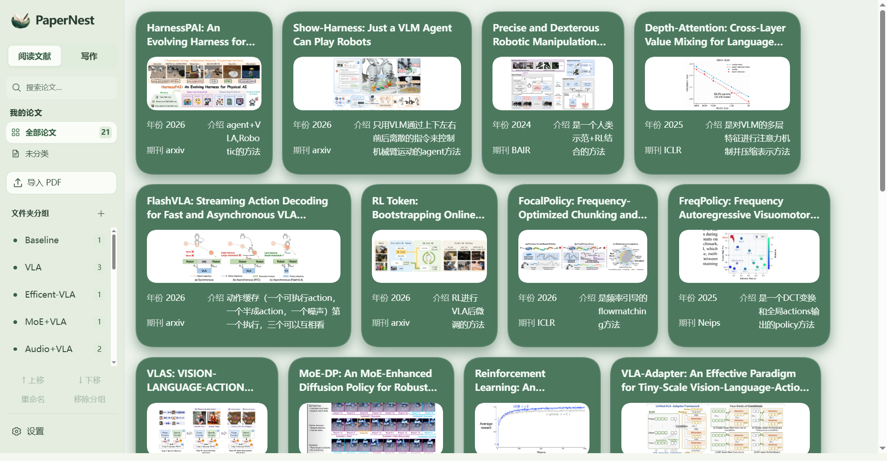
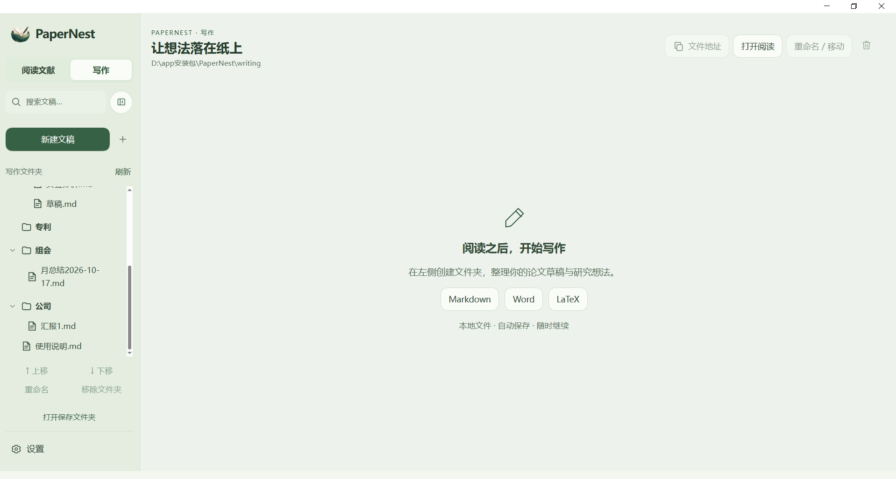
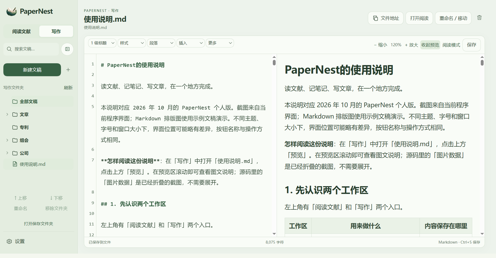
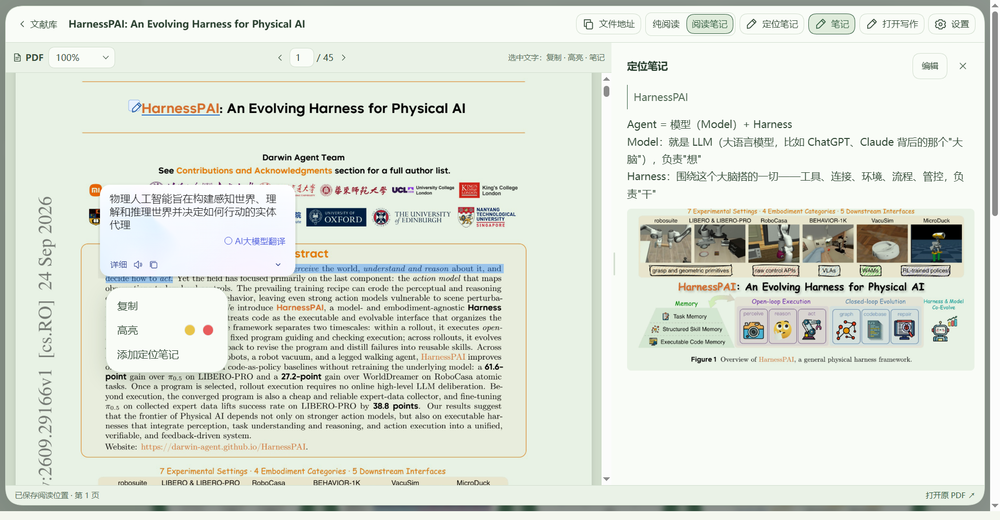

# PaperNest

PaperNest is a local Windows workspace for reading papers, keeping research notes, and writing in one place. It keeps your PDFs and drafts on your computer and combines a clean PDF reader with a separate Markdown, Word, and LaTeX writing area.

## Highlights

### Organize papers without losing context

- Import PDFs into a local library and keep the original PDF layout.
- Create your own groups and assign one paper to several groups at the same time.
- Remove a paper from one group without deleting the paper itself.
- Reorder, rename, or remove groups; paper order follows import order.
- Edit the year, journal, summary, and cover image on each paper.
- Maintain a searchable personal Q1, Q2, Q3, and Q4 journal catalogue.

### Read, highlight, and take notes

The reader supports continuous PDF scrolling, zoom, text selection, yellow or red highlights, highlight comments, anchored notes, and pasted note images. **Reading mode** gives the PDF the whole workspace; **Reading + notes** keeps the note panel available.

The reader also has a copy-path button. It copies the absolute path of the original PDF, which is useful when opening a file in another tool or sharing its location with a coding assistant.

### Write beside your papers

The writing workspace is stored separately in writing/. Create folders and edit Markdown, Word, or LaTeX files with autosave, drafts, search, rename, move, and remove controls.

Markdown includes heading levels, styles, paragraphs, lists, tables, code, formulas, pasted images, image-data folding, live preview, reading mode, and writing zoom. LaTeX includes English and Chinese templates, XeLaTeX compilation, PDF preview, error reporting, and PDF download.

You can open a paper while writing, or open a writing document while reading. PaperNest places reading and writing side by side and lets you resize the split. Links can point to PaperNest papers, writing documents, folders, or local paths; external PDFs open in the browser and other external files use the Windows default application.

### Translation through Baidu Translate Desktop

PaperNest's built-in translation and automatic selection translation are disabled. This keeps the application local and avoids requiring a model API key. For selection translation, use the separate **Baidu Translate Desktop** application:

1. Download the Windows desktop client from the [official Baidu Translate download page](https://fanyi.baidu.com/download?appchannel=wisebottom).
2. Install and start Baidu Translate.
3. Enable **划译** (selection translation) in the desktop client.
4. In PaperNest, choose **Reading + notes**, select text in the PDF, and let Baidu Translate show the translation overlay.
5. Choose **Reading mode** when you want to select or copy text without PaperNest's annotation menu.

PaperNest does not call a Baidu API or upload your library. The Baidu desktop client reads the selected screen text when its own划译 feature is enabled; its account, availability, and limits are controlled by Baidu and may change between releases.

## Installation

PaperNest currently ships as source code for Windows. Install:

- Python 3.10 or newer
- Microsoft Edge WebView2 Runtime
- Git (optional, if downloading with git clone)
- XeLaTeX/TeX Live (optional, for LaTeX preview)

    git clone https://github.com/AlimMat/PaperNest.git
    cd PaperNest
    python -m venv .venv
    .\\.venv\\Scripts\\python.exe -m pip install -r requirements.txt
    powershell -NoProfile -ExecutionPolicy Bypass -File .\\scripts\\build-desktop.ps1

The desktop build downloads the WebView2 SDK from Microsoft NuGet on its first run. Start PaperNest with 启动PaperNest.vbs. To create a desktop shortcut, run:

    powershell -NoProfile -ExecutionPolicy Bypass -File .\\setup-desktop.ps1

There is no separate installer yet. You can also use **Code → Download ZIP** on GitHub and run the same setup commands after extracting it.

## Basic usage

1. Start PaperNest and click **Import PDF**.
2. Create or select a group before importing; imported papers are added to that group.
3. Open a paper and choose **Reading + notes** for highlights, comments, and anchored notes.
4. Click **Writing**, create a folder and a document, and write in Markdown, Word, or LaTeX.
5. Use **Open reading** from the writing area, or **Open writing** from the reader, to work in a split view.
6. Use **Settings** to change theme, PDF background, font sizes, and sidebar widths.

## Data and privacy

- Papers and reading metadata are stored in data/ by default.
- Writing documents are stored in writing/.
- These personal directories are ignored by Git and are not part of the public repository.
- PaperNest listens on localhost and does not require an online account for reading or writing.
- Scanned PDFs, complex Word layouts, and multi-file LaTeX projects may need external tools.

## License and acknowledgements

PaperNest is released under the [MIT License](LICENSE).

PaperNest is a substantial second-party development based on [EzRead](https://github.com/zhuangcao136-glitch/EzRead). Thank you to the EzRead project for its original PDF reader foundation, library model, and extensible code structure. The compatible modules and original license notices are retained in this repository.
