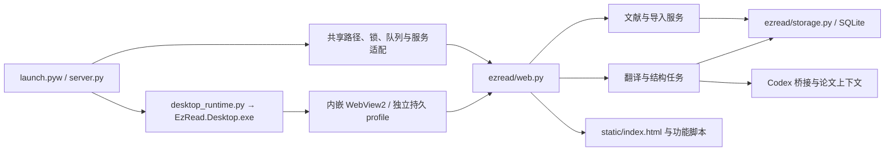

# PaperNest 架构

界面品牌为 PaperNest，图标为纸页、小窝与钢笔，源图 `static/papernest-icon.png`，Windows 图标 `static/papernest.ico`。桌面构建输出 `PaperNest.Desktop.exe`；启动器仍兼容旧 EXE。保留 `ezread` 模块、环境变量、保存键、互斥标识与数据目录，以保持既有文献和草稿兼容。新入口为 `启动PaperNest.vbs`，原启动入口也保留。

项目采用本机 Python HTTP 服务、SQLite 和原生网页界面，Windows 启动入口使用独立 WinForms 窗口内嵌 WebView2。用户可以让自己的编程助手直接修改源码，再刷新界面或重启后台加载改动。原有 HTTP 接口、数据格式和交互保持兼容。

主窗口收到关闭请求后先保存窗口位置并立即隐藏主窗口及其已显示的子窗口，保留 WebView2 完成前端笔记、阅读位置、偏好和本机草稿保存，再通过绑定实例的 `/api/shutdown` 退出后台。保存未确认或关闭异常时恢复窗口并提示重试；关闭准备期间重复启动不会重新唤醒窗口。`ezread/lifecycle.py` 取消在途选区与任务、保留重译 staging 并持久化暂停状态，停止接收新请求。模型通道通过 `ezread/processes.py` 统一登记自己的进程；后台和原生宿主各自使用 Windows Job Object，让进程退出时内核清理剩余模型／WebView2 后代。宿主绑定后台的实例 ID 和稳定进程句柄，避免 PID 重用误关其他进程；`/api/desktop-attach` 只监视当前应用目录的真实桌面 EXE，宿主异常退出也触发后台清理。启动器等待正在退出的旧实例释放端口，下一次打开创建新后台。关闭子窗口和重复启动唤醒均不退出主窗口的后台。

`scripts/verify-exit.py --executable <workspace-build>/EzRead.Desktop.exe` 在独立库中验证两轮关闭／重开、任务草稿与笔记保留、后台及模型后代退出、后台崩溃清理，以及宿主崩溃后的后台和 WebView2 清理；模型进程均为本地模拟进程。

## 入口与依赖

`server.py` 是组装入口，定义每个服务实例使用的路径、锁、任务队列和默认设置，并以兼容函数委托给 `ezread/`。这些函数也是既有测试和本地脚本的调用入口。

本地 `PaperNestHTTPServer` 将待接收连接队列设为 64，容纳 WebView 冷启动同时加载脚本、样式和桌面健康轮询，避免默认五个待接收连接在突发期间丢失页面资源。仍为标准库多线程 HTTP，绑定回环地址。

`ezread/context.py` 定义 `ApplicationContext`：服务需要哪些共享状态与操作。运行时由入口模块提供，调用时显式传入。业务模块不导入 `server`，所以没有循环导入；测试可以注入临时路径、模拟模型调用与独立队列。当前契约保留既有全局命名，尚未把应用转换成多实例对象。

| 后端模块 | 职责 |
| --- | --- |
| `config.py` | 统一版本、环境变量、相对路径解析与旧变量只读兼容 |
| `storage.py` | 建库、连接、文献 CRUD、设置存储与重启后的任务状态恢复 |
| `preferences.py` | 设置和阅读状态的校验 |
| `library.py` | 对外文献数据、元数据、源文件操作 |
| `imports.py` | PDF 签名、哈希去重、提取、导入与失败清理 |
| `publication.py` | 用户确认后的出版信息检索、匹配、补空与来源追踪 |
| `structure.py` | 原文整理队列、源指纹验证与原子提交，保留既有合集归属 |
| `translations.py` | 模型快照、历史版本、草稿、重译暂存与完整提交 |
| `tasks.py` | 通用队列、取消、继续、额度暂停与连接状态缓存 |
| `overview.py` | 研究速览结构校验、历史消息与模型交接的文本格式 |
| `web.py` | HTTP 契约、输入校验、静态资源与媒体路由 |
| `journal_catalogue.py` | 个人期刊名单热加载、排序、校验、版本冲突、原子保存、历史快照和 Codex 修改预览 |
| `utils.py` | 无状态工具 |

根目录的 `pdf_tools.py`、`paper_ai.py`、`codex_bridge.py`、`codex_models.py`、`codex_usage.py`、`journal_tiers.py` 与原生 Windows 辅助模块是独立适配器；`ezread/` 中的应用服务调用这些适配器。`paper_structure.py` 加载随源码分发的论文导入流程。完整定位表见根目录 `AGENTS.md`。

## 目录边界

| 位置 | 保存内容 |
| --- | --- |
| 根目录入口与适配器 | 启动、桌面与外部能力连接，不保存历史实现副本 |
| `ezread/` | 按职责划分的后端应用服务 |
| `static/` | 当前界面脚本、样式、图标与内置期刊名单 |
| `desktop/` | 原生窗口源码与 manifest；`bin/` 是忽略的构建产物 |
| `assets/`、`skills/` | 公共资源、授权信息和随软件分发的论文导入流程 |
| `scripts/`、`tests/` | 可复用维护工具与离线回归 |
| `docs/` | 架构与开发说明 |
| `data/` | 私人论文库、阅读状态与浏览器 profile，不提交 |
| `work/`、`output/`、`.deps/` | 本机诊断、验证产物与依赖缓存，不提交 |

历史源码由 Git 和 `work/backups/` 保存；旧的一次性诊断与截图归档到 `work/archive/`，不作为当前可执行入口。旧环境变量、浏览器保存键、段落批注与草稿迁移属于有效兼容逻辑，集中保留在对应模块。

出版信息联网查询统一进入 `publication.py` 的用户确认流程；已移除未被业务调用的旧 `crossref_metadata` 函数及其入口适配。划线译文由当前选区卡片展示，不再保留旧段落内译文列表的状态和样式。旧段落编辑器只承担未保存草稿的恢复，不能与停用的段落操作栏一起删除。

## 前端

### 独立写作工作区

阅读分组与写作文件夹的底部操作区提供“上移／下移”，每次交换相邻一位。阅读顺序保存在 SQLite 的 collections 设置中，collections_ordered 标记启用手动顺序；未调整过的库仍按名称显示。移动不更新论文记录、归属或导入顺序，重命名保留手动位置，新分组追加到末尾。写作顺序独立保存在根目录隐藏文件 `.folder-order.json`，使用锁和原子替换；仅对同一父目录内的文件夹排序，文稿继续按原顺序显示，子树保持附属于父文件夹。重命名同步替换后代路径，移除清除顺序记录，顺序写入失败回滚对应目录移动。前端调整仅刷新侧栏并保持滚动与编辑器，不重建当前文稿。

`ezread/writing.py` 管理真实目录与 `.md`／`.tex`／`.docx`，通过显式传入的 ApplicationContext 解析 ROOT、DATA，不读写论文 SQLite。默认根目录为 `ROOT/writing`，自定义数据目录时为 `DATA/writing`。GET `/api/writing` 返回目录树，GET `/api/writing/document?path=...` 读取文稿，POST `/api/writing` 执行创建、保存、重命名／移动、移到本地回收目录、复制当前文稿绝对路径和打开根目录。所有路径限制在写作根目录内，拒绝隐藏文件、系统保留名称、路径穿越和符号链接／联接；继承现有 Host／Origin 校验。复制地址前前端先保存当前编辑内容，后端只返回由写作根目录和相对路径解析出的已有文稿地址。UTF-8 文本与标准 OOXML Word 文件直接落盘，保存使用内容 SHA-256 冲突检查、锁、临时文件、fsync 和原子替换。Word 仅承诺基础文字格式，拒绝已识别的表格、图片、脚注、批注等复杂内容，避免静默删改。

`static/writing.js` 通过公共 api、DOM 工具和 `core/state.js` 中的 writingState 管理目录与编辑器，独立 `writing.css` 适配现有主题／字号。编辑不重绘输入节点，900 ms 防抖、串行保存，切换文稿／模式前 flush；本机草稿按根目录和相对路径隔离，成功保存当前版本后才删除。`writing-drafts.js` 串行保存 IndexedDB 草稿，避免嵌入图片超过 localStorage 配额，保留旧 localStorage 草稿读取与降级写入。外部修改冲突保留两边内容，提供另存草稿或明确放弃后重读。Word 粘贴为纯文本、仅允许基础标签。desktop.js 关闭握手等待文稿保存，失败／文件操作未完成时拒绝关闭，阅读笔记保存契约不变。写作不触发翻译、模型或 PDF 导入；LaTeX 预览按下述流程编译。

`writing-tabs.js` 在工具栏显示当前会话已打开文稿的标签，按打开顺序排列、同一路径不重复；纯阅读时置于缩放／打开阅读按钮左侧，窄栏可横向滚动。点击切换前走原串行保存，失败保留原标签及草稿；× 仅关闭标签并释放编辑缓存，不删除磁盘文件。关闭当前标签转到相邻文稿，最后一项关闭回空白写作页。Markdown 复用 CodeMirror.Doc 保存撤销及光标，独立保存各标签编辑／预览滚动；重新激活时核对磁盘 revision，外部改变则重新读取，不用旧缓存覆盖。重命名／移动文件夹同步更新所属标签路径，移除清除相应标签。标签只在本次应用会话中保留。

写作顶部标题／文件操作栏也可折叠：进入 Markdown 或 LaTeX 预览时自动缩成窄条，保留一个可键盘访问的展开按钮；按钮可恢复标题、文件地址、打开阅读、重命名和移除操作。状态保存在浏览器设置中，Word 切换时自动恢复完整标题栏，不影响编辑器宽度、源码内容或滚动位置。

三种文稿共用 `writingActionMenu` 和现有增强下拉控件；保留五个格式功能菜单、预览、阅读模式和保存，增加独立的缩小、放大按钮和比例显示，可见操作入口不超过十二个。Markdown 分为标题、样式、段落、插入、更多；Word 分为格式、样式、段落、插入、编辑，并把 H1–H6、删除线、上下标及简单列表安全转换为 OOXML；LaTeX 分为排版、结构、样式、插入、公式。具体命令只在菜单选择后执行，保持键盘访问和窄窗口布局。

Markdown 预览块携带由解析 token 映射来的源码行号；双击预览文字后，从当前块源码起点查找选区文本，定位并选中 CodeMirror 中的原文，不改动文稿。若浏览器没有保留双击选区，则从指针坐标读取词语，中文和拉丁字符都可定位。

写作缩放以 10% 调整，范围 50–200%，保存在统一浏览器设置 `writingZoom`。只改变编辑正文、Markdown 预览和 LaTeX PDF 页面的显示，不修改文稿内容或工具栏字号；阅读模式和边读边写共用比例。CodeMirror 通过字号重新测量并保持相对滚动位置，预览内容与 Word 通过局部 CSS zoom 缩放，LaTeX 页面按比例调整宽度，超出部分在预览内部滚动。窄窗口工具栏可换行。

写作模式的主侧栏可折叠为仅保留 PaperNest Logo 与背景色的窄栏；折叠按钮始终留在窄栏内，主写作区通过同一宽度变量同步扩展。该偏好保存在浏览器状态中，离开写作模式时文献侧栏恢复完整显示，再次进入写作时恢复上次折叠状态。宽度变化后刷新 CodeMirror 与布局观察者，不重建当前文稿或预览。

`sidebar.js` 在主侧栏右边缘提供拖动分隔线，支持左右方向键、Shift 大步调整和 Home／End。阅读和写作分别通过 readingSidebarWidth／writingSidebarWidth 保存展开宽度，范围 184–480 CSS px，实际宽度还限制在窗口宽度的 45% 内；窄窗口临时夹紧显示，保留原保存值。模式切换及重启恢复各自比例，写作折叠不覆盖展开宽度。拖动复用 CSS 侧栏宽度和主区偏移变量，文献布局观察者与 CodeMirror 自行响应，不重建文稿；结束后通知桌面更新窗口宽度下限。

写作文件树按真实目录层级显示。每个有内容的文件夹在名称左侧提供独立展开按钮，收起时只隐藏其后代，不改变当前文稿、目录选择或磁盘内容；点击文件夹名称仍只负责选择新建、重命名和移除的目标目录。搜索时临时显示命中项及其父目录，清除搜索后恢复此前的展开状态。

写作侧栏仅 `#writing-tree` 文件树滚动，占用固定控件之间的剩余高度；搜索、新建、文件夹标题、刷新以及下方重命名／移除、打开保存文件夹、设置保持固定。滚动到文件树边缘不传递到外层；侧栏收起后仍保留展开按钮。

`writing-markdown.js`／`.css` 提供 Markdown 专用 CodeMirror 编辑器、H1–H6 与常用写作工具栏、图片粘贴／选择／拖放以及预览。CodeMirror 的可逆 markText 只折叠 Base64 的显示，不改变真实源码、选区复制与撤销历史。图片原字节通过 FileReader 转为 data URL，验证可解码的 PNG／JPEG／GIF／WebP，单图 8 MB／4000 万像素；Markdown 文件上限 32 MB，Word／TeX 仍为 2 MB。只对写作 POST 放宽 JSON 请求上限到 72 MB，覆盖转义开销，其余接口仍 4 MB。图片插入用书签保留光标位置，flush 等待在途插入再保存，避免切换或关闭时丢图。字符统计不包含图片编码。

Markdown 普通输入只更新文稿状态和防抖预览，不刷新 CodeMirror 几何；视图切换、侧栏调宽及双栏装卸等确需刷新时保存并恢复编辑器滚动位置。图片 Base64 折叠标记重算也保持当前滚动位置，预览重绘独立保持自己的滚动位置，避免在长文稿中输入时任一栏跳回顶部。

预览使用 markdown-it（禁用 raw HTML）及 KaTeX（trust:false、有界宏展开），支持表格、待办与 `$...$`／`$$...$$`／`\(...\)`／`\[...\]` 公式。仅显示内嵌栅格图片，外部图片为占位，不自动发送网络请求。CodeMirror 5.65.21、markdown-it 15.0.2、KaTeX 0.19.0 及字体、MIT 授权全部内置于 `static/vendor`，无 npm 构建、运行时 CDN 或数据库迁移；`scripts/vendor-writing-libs.py` 按固定版本和 SHA-512 校验恢复这些资源。

`writing-links.js` 的“插入 → 链接”可输入网址、复制的本地绝对地址或相对当前文稿的路径，也可搜索选择论文、文稿和写作文件夹。Windows 地址转换为编码的 file URI；库内选择生成 `papernest://paper/<id>` 或 `papernest://writing/<path>`。Markdown 只额外放行 file／papernest 链接，仍拒绝 JavaScript、危险 data URI 与原始 HTML；本地链接统一拦截，不交给 WebView 导航或将相对路径当成 HTTP 页面。库内论文复用 readwrite 的左 PDF／右写作；文稿与文件夹用独立只读左栏（Markdown、基础 Word、实际 LaTeX PDF 或子项列表）。移动同一个 writing-view，不重建右侧编辑器，不切换当前文稿，左栏可关闭和调宽。左侧文稿的相对链接以左侧文稿为基准；退出双栏、切换阅读或转到 PDF 时解除引用栏。

`ezread/writing_links.py` 与 POST `/api/writing/link` 只解析链接。此功能按用户明确要求允许现有本机外部路径，其他文件 API 的目录限制不变。来源必须是有效写作文稿，拒绝 UNC／设备路径、其他协议、替代数据流和程序／脚本／快捷方式。库内路径仍走 writing 的校验或以文献 ID 打开原始 PDF，不遍历资源或修改库。外部目标显示完整路径确认，POST `/api/writing/link-open` 只接受解析时的随机短期票据，绑定 data 目录和目标文件状态；常见文档／图片／媒体／压缩文件和文件夹交给系统默认程序，PDF 在默认浏览器打开受票据保护的只读 HTTP 原文件。不接受任意路径 GET，不执行命令字符串、不自动导入外部文件、不自动读取外部 Markdown。保留 Host／Origin 校验。测试入口 `test_writing_links.py` 和 `verify-writing-links.py` 使用独立库和模拟系统启动，覆盖插入／搜索、嵌套相对链接、双栏编辑身份、原始 PDF、确认／取消、窄窗口与协议保护。

Markdown 和 LaTeX 的“预览”保留编辑器与预览双栏；“阅读模式”先完成保存，隐藏编辑器、标题／文件操作、格式工具、保存操作与底部统计，紧凑顶部条从左到右保留缩小、比例、放大、打开阅读和退出阅读，预览占满剩余正文区域。缩放复用同一写作比例，不退出阅读或改变文稿。退出恢复之前的预览开关和完整布局，保留编辑节点、光标、撤销与滚动。LaTeX 正常阅读时隐藏编译／下载条，编译中、失败或过期时保留必要状态提示，退出后可继续编译；未保存草稿的恢复提示不隐藏。切换仅改变显示，不重建编辑器文稿；Word 不显示这两个模式按钮。

`writing-images.js`／`.css` 为 Markdown 预览、阅读模式和链接文稿中的内嵌图片提供可键盘访问的独立大图弹窗。复用渲染器已验证的原始 data URL，不重新编码或写文件；嵌套在链接中的图片点击只打开大图，不跳转链接。原生 modal dialog 位于阅读／写作双栏弹窗之上，初始适应窗口，支持独立缩放、原始大小、重新适应、拖动与滚动查看，以及 Ctrl＋滚轮按指针位置缩放。关闭释放图片引用并恢复原图片焦点，不修改编辑器、正文缩放或阅读位置；远程图片仍不自动加载。

`writing-latex.js` 与 `ezread/writing_latex.py` 提供单文件 LaTeX 排版。新建时选择中文 ctexart 或英文 article 模板，工具栏可切换标准 article/report/book 与对应 ctex 类，只更改文档类、保留正文，不翻译内容。首次显示 LaTeX 预览自动保存并调用 POST `/api/writing/latex-preview`，之后修改标记为待更新，由用户点击“重新编译”。界面显示真实 PDF 页面及下载入口；错误显示编译行号并保留原稿及上次成功的预览，迟到结果不覆盖其他文稿。

后端使用 PATH 中的 XeLaTeX，在独立临时目录编译两轮，禁用 shell escape，设置 openin_any/openout_any=p，每轮最多 40 秒，通过 processes 登记进程以便应用退出时停止。输入仅为已保存且 revision 匹配的单个 .tex，不复制用户目录、不执行 BibTeX 或外部构建脚本，暂不支持项目内图片／子文件依赖。输出限定 24 MB、200 页，PDFium 在共用锁内渲染高清页面。预览仅放内存缓存，最多 8 份／64 MB，访问限当前写作根目录和随机 token，两小时后需重新编译；不向文献库导入记录或写入用户稿件目录。GET `/api/writing/latex/<token>/<page>.png` 与 `document.pdf` 沿用本机来源校验。

验证入口：`tests/test_writing.py` 测试路径、原子保存失败、冲突、OOXML 和大文稿；`scripts/verify-writing.py` 在独立目录和端口执行 `browser_writing.cjs` 与 `browser_markdown.cjs`，覆盖三种格式、标题／公式、二进制图片粘贴与折叠、完整复制／撤销、字节保真保存／重开、超 localStorage 配额的草稿恢复、关闭保存、冲突另存、重命名／移除、搜索、安全渲染与窄窗口。`verify-exit.py` 另验证真实 WebView2 关闭握手保存未提交 Markdown。

写作复用既有原生窗口适配协议（`dialogOpen` 的实际作用是切换为窗口高度），切换模式主动发送 `ezread-fit-viewport`。写作编辑器和侧栏各自滚动，短窗口中也能访问状态栏；切回阅读后恢复原文献库的固定页面高度和原生平移模式。

`static/readwrite.js`／`.css` 组合现有 PDF 阅读器与写作区。「打开阅读」从写作页选择论文，「打开写作」从阅读器进入双栏；reader-dialog 保持原生模态语义，reader-content 在左，将同一个 writing-view DOM 节点暂时移到右侧容器，不复制编辑状态、不重新加载当前文稿。退出前 flush 写作并将节点移回原 main.workspace，失败保留双栏；阅读位置及论文笔记继续走 readerPreserveLayout、closeReader 和桌面关闭的既有保存流程。论文／文稿选择窗口支持标题、分组或路径搜索，新建文稿使用原创建窗口。中间分隔线支持拖动、方向键及 Home 复位，左右各占 30–70%。双栏里的论文笔记在左栏下方展开，写作预览在右栏内部上下排列，避免挤成四列。Ctrl+S 与图片拖放按双栏状态识别，防止误触发 PDF 导入。`verify-pdf-selection.py --readwrite-only` 使用独立文献库验证双向入口、编辑节点保留、论文／文稿切换、保存失败、调宽、笔记及关闭保存。

### 当前极简 PDF 阅读视图

选中阅读分组后，通过文件选择器或向窗口拖入 PDF 会将整批文件加入导入开始时的分组，完成后仍显示该分组；其他视图的导入不指定分组。multipart 的可选 collection 字段在读取所有文件前解析，后台验证目标仍存在，再在论文写入时保存手动归属。重复 PDF 复用已有记录并追加目标归属，保留其他分组、笔记和导入顺序。未指定分组的接口调用保持未分类导入，后台结构整理不自行分组。

当前设置包含外观与字号、期刊信息、文献与备份、关于。文献库侧栏和阅读器均可打开设置。「期刊信息」改为独立的个人期刊库，保留原来的列表、搜索、字母导航和编辑布局；按 Q1／Q2／Q3／Q4／未分区管理，名称和分区必填，其他字段可选。`ezread/personal_journals.py` 使用稳定随机 ID、revision 冲突检测、进程锁、原子替换和历史快照保存到 `data/personal-journals.json`，独立于旧的 `journal_tiers.csv`，不修改 SQLite 或现有论文文档。完整导出包含个人期刊库。`/api/personal-journals` 提供 GET/PATCH；公开论文通过全称优先、唯一别名匹配得到个人分区，冲突别名不猜测，不用旧 ISSN 覆盖用户选择的刊名。两个论文信息表单都使用可搜索的期刊选择器，也允许自由输入。

翻译在 `ezread/features.py` 中以 `TRANSLATION_ENABLED = False` 停用。网页移除所有正常界面中的翻译入口，启动只读取本地 health、settings 和 papers，不再准备会话或读取模型账户。HTTP 拒绝新划词、句子、全文翻译、重译及旧 ai/highlight 翻译请求；任务入队和 worker 也阻止翻译执行。旧译文、草稿、底层实现和兼容测试保留，历史测试须显式打开测试内的特性开关，新产品测试验证默认关闭。下文旧版翻译和等级流程仅描述保留的实现，不代表当前可用功能。

文献列表固定按数据库插入顺序（`rowid ASC`）显示，先导入在前、新导入追加在末尾；更新记录保留 rowid，阅读、标题、年份、笔记修改和轮询不改变相对顺序。筛选与分组只过滤列表，不重新排序。旧浏览器排序偏好不再参与显示，已移除隐藏排序控件与事件。删除后后续卡片补位，重新导入作为新记录排在末尾；窗口宽度或介绍长度改变时只调整换行与几何位置，文章先后顺序不变。

文献库卡片高度固定（随界面字号一起调整），顶部原始标题预留两行，标题下方封面铺满卡片内容宽度，高度保留原先 88px × 4/3（约 117px）。封面下方分为两列：左侧上下显示年份和期刊，右侧显示三行介绍。短介绍保持原紧凑卡宽；仅介绍超过三行的卡片按实际文字换行自动向右加宽，其他卡片宽度不变。介绍变短后该卡片缩回。最大宽度不超过文献列表可用宽度，极长介绍在三行后省略，点击介绍仍可查看、编辑完整内容。封面保持原图比例完整显示，不裁切、不拉伸；加载失败显示占位。
点击任意信息行打开编辑窗口，复用 year、journal、summary 保存三个字段；期刊显示填写的原名，介绍不回退为摘要，空值提示点击填写。
编辑窗口同时显示当前封面，“更换封面”按需加载论文已提取的插图供单选和预览，点击保存后通过既有 cover 接口设置；取消不改变封面。未选择新图时保持当前默认封面，无插图时给出空状态提示。
点击标题或卡片空白处打开论文；完整简介、全文翻译及收藏从右键菜单访问，拖动分类和多选保留。卡片介绍预留三行，先扩宽该卡片，达到窗口边界后才省略，不自动生成或联网补全。
在分组视图中，卡片右键菜单提供“从「分组名」分组移除”，多选栏提供“从当前分组移除”。操作只更新分组归属，保留 PDF、笔记及其他分组；取消最后一个分组后仍可在全部论文和未分类中找到。多选移除仅作用于属于当前分组的已选论文，失败时保留选择以便重试。

阅读侧栏的分组列表下方常驻“重命名”和“移除分组”，仅选中分组时启用，复用创建分组的表单窗口。移除需确认，操作仅移除该分组及其成员归属，保留全部论文文件和笔记。POST `/api/collections` 的 create／rename／remove 由 `library.mutate_collection` 在同一锁和 SQLite 事务中更新设置与论文成员列表，兼容旧 collection 字段并保留 rowid；重复名称、无效名称和过期源名称均拒绝，写入失败整批回滚。轮询在操作期间暂停应用旧响应，空分组变化也刷新侧栏。`test_collection_management.py` 和 `verify-collections.py` 在临时库检查多分组、旧字段、空分组、回滚及文件保留。

阅读侧栏仅 `#collections-nav` 分组列表独立滚动，搜索、分类、导入、分组标题、重命名／移除及设置固定；列表占剩余高度，滚动到边缘也不传递到外层。桌面阅读侧栏滚轮不再发送整页平移消息，列表内部保持浏览器原生滚动，其他固定控件上的滚轮不移动页面。写作侧栏沿用原行为。
“彻底删除”与移出分组分开：确认后删除文献记录、PDF 资源目录、笔记、批注、译文、AI 对话、临时复制文件和本机阅读草稿，不保留回收站记录。再次导入相同 PDF 分配新 ID、重新提取内容；未删除论文仍按哈希去重。旧回收站论文再次导入时先清除旧记录。导入后续步骤失败时同时清除已写入的数据库行，防止留下占用哈希但缺失 PDF 的记录。

阅读器只呈现原 PDF 页面与可收起的笔记栏，不再挂载原文／译文重排栏或语言切换按钮。
原 PDF 字节不变，PDFium 以较高分辨率渲染保持页面布局；`reader-pdf.js` 在其上覆盖按印刷行组织的透明文字层，
让同页划选像网页正文一样连续，直接使用复制、黄／红高亮、定位笔记、离线查词及句子翻译菜单。
跨行划选按源段落合并范围，沿用原文中的空格和断词规范化；跨段落仍分别保存范围。DOM 的 UTF-16 偏移与持久范围的 Unicode code point 偏移在选取和重绘时相互转换。
这不是浏览器内置 PDF 插件：插件选区无法供外层菜单读取。

`GET /api/papers/<id>/pdf-text/<page>` 按需读取字形坐标，用现有源块 ID 和 Unicode
字符偏移匹配原文，处理空格、连字和断行连字符；低匹配度、扫描文字和公式不猜测坐标。
定位笔记继续复用已有 text-actions API、图片上传、串行保存及离线草稿，不迁移数据库。
已有定位笔记默认展示标题、文字和图片，点击“编辑”才打开编辑器；保存或取消后回到展示。已有笔记的未保存草稿通过“继续编辑草稿”恢复，新建笔记直接编辑。
高亮批注与定位笔记按记录的 `kind` 区分：高亮文字点击后在文字下方显示批注卡片，在同一浮层编辑，查看和编辑时均不重复显示原文引用；不打开右侧笔记栏，也不生成定位笔记图标或蓝色下划线。批注仍保存在原高亮记录上，已有批注文字和图片保留；批注草稿按高亮 ID 独立保存，避免覆盖定位笔记草稿。
高亮批注卡片和编辑框可按住标题拖动，也支持标题聚焦后用方向键移动。位置限制在窗口内，窗口缩小时重新约束；查看、编辑和保存之间沿用当前浮层位置，关闭后再次点击高亮则回到文字附近。拖动不重建内容，关闭浮层时解除拖动与窗口尺寸监听。
阅读器提供“纯阅读／阅读笔记”切换，记住本机选择，默认沿用阅读笔记模式。纯阅读关闭划选自动菜单及自定义右键选区菜单，保留原生选择、复制和已有批注；不关闭或重建正在编辑的笔记。切换会清理待弹菜单、取消在途划线翻译并退出定位放置状态。
阅读器顶部的“文件地址”按钮通过 `POST /api/papers/<id>/copy-path` 取得当前论文库内 `original.pdf` 的服务端解析绝对路径，并在浏览器端复制为文本；接口只接受论文 ID，不接受客户端提交的任意路径，也不影响“复制 PDF”文件操作。
旧译文、双栏位置与修订数据保留兼容，但不在当前阅读视图中重排显示。

阅读器顶部增加设置入口。外观设置复用公共偏好队列，保存主题、界面／笔记字号、PDF 周围背景、纸张底色及笔记栏宽度。
纸张底色通过显示层混色实现，不修改 PDF，原始白色保持插图原色。笔记栏左侧分隔线支持拖动和方向键调宽，
拖动不重建笔记编辑器；宽度保存为 260–720 CSS px，窄窗口限制实际宽度，低于 700 px 时上下排列。

`scripts/verify-pdf-selection.py` 使用临时数据库、合成双栏 PDF 和无界面 Edge，
验证实际鼠标选区、菜单、高亮／笔记持久化、缩放和窄窗口；翻译响应模拟，原文件字节逐项核对。
下文涉及双栏的说明属于兼容逻辑，当前界面以本节为准。

`index.html` 用经典 `defer` 脚本明确加载顺序；无需 npm 或打包。各文件定义函数，只有最后的 `app.js` 执行初始化。先加载的阅读器与弹窗在用户操作时调用公共函数，此时所有脚本已加载。

- `core/`：共享状态与常量、DOM、显示格式、偏好和 HTTP 请求。
- `core/storage.js`：统一 `ezread-*` 保存键，将旧缓存迁移到新键；写入失败保留旧值。
- `library/`：文献操作、筛选排序、卡片布局、多选、拖动和导入。
- `detail/`：论文简介、笔记保存、元数据和封面操作。
- `tasks/`：任务列表、连接状态和额度展示。
- `reader.js`、`paper-chat.js`、`translation-ui.js`、`settings-ui.js`：现有独立功能。
- `app.js`：绑定事件、轮询和启动。

当前是按功能分文件的经典脚本模块，仍共享状态和公共函数。新增功能应沿用 `state`、`api()`、`patchPaper()` 等公共契约，避免复制状态。没有声称完成 ES Module 封装；若未来规模需要，可逐个迁移，而不是一次重写界面。

论文问答通过 `/api/papers/<id>/ai/chat-stream` 返回 NDJSON 事件，由 `core/api.js` 的 `apiStream()` 按 UTF-8 分段读取。发送时立即显示提问和等待计时；`paper_ai.CodexSession` 转发当前 thread/turn 的状态、可读推理摘要和回答增量，前端按论文与对话版本隔离在途状态。结构化输出只提取 `answer` 字符串作预览，最终回答通过原有引用校验后再原子保存；推理摘要沿用消息表的 `reasoning` 类型，重新打开可折叠查看。模型未提供摘要时只显示真实等待状态。`paper-chat-markdown.js` 用安全 DOM 节点渲染 Markdown，不执行输出中的 HTML。对话消息不显示用户和助手角色标签。宽窗口可拖动面板左边界或用方向键调整宽度，通过统一浏览器设置保存；窗口变窄时夹紧宽度，纵向排列时占满容器，恢复宽窗口后恢复已保存宽度。打开 Codex 使用 `/ai/open` 从已保存版本取得会话编号，再由本机协议处理器打开，避开 WebView2 的外部 HTTP 链接限制；前端收到请求失败时明确提示。

`journal-catalogue-ui.js` 提供设置中的期刊等级面板；HTTP 与 CLI 共用 `ezread/journal_catalogue.py`。内置 CSV 只读作为初始值，当前 data 目录的个人 CSV 保存完整名单，按内容摘要作为 revision；写入使用跨进程锁及原子替换。公开论文每次按当前有效名单计算评级，轮询签名包含等级与身份冲突标记，让文件编辑也能更新颜色和筛选。Codex 仅生成 JSON 操作预览，验证后通过同一保存入口应用，不直接写源码或文献库。

样式按 `style`、`preferences`、`reader`、`redesign`、`surfaces` 的顺序覆盖。最后一层统一圆角与柔光。

主题仅保留纸白、浅绿和石墨，设置选择器与前端归一化共用 `THEME_CHOICES`，后端读取与校验共用 `THEMES`。数据库或浏览器缓存中的无效主题回到纸白，其他偏好照常保留；已移除主题不再保留专用样式和选择分支。

文献库使用原五列基准的紧凑卡宽作为每张卡片的最小宽度，按介绍内容独立扩宽；等高卡片按排序顺序逐行摆放，从内容区左上角开始排列，宽度不足时换行，不因卡片数量少而居中。主桌面窗口根据当前显示器可用区域的长边及 DPI 设置 WebView2 缩放；普通窗口拉伸不改变比例，竖屏自然减少每行卡片数量。窗口最低宽度为两列完整卡片所需宽度（含侧栏、边距及网页滚动条占位）与当前显示器可用区域半宽的较大值，最低高度仍为可用区域的一半；跨显示器、DPI 或界面字号变化时重新计算。WebView 宽度始终适配窗口，不提供横向滚动或横向平移，也不需要横向滚动条的高度补偿。滚动条和边框按当前窗口 DPI 读取，以原生客户区的实际像素宽度约束页面，避免旧 WinForms 系统 DPI 缓存在跨显示器后产生数像素溢出；网页根节点也禁止横向滚动，内部 PDF 等独立滚动区保持原有行为。主窗口不显示外层纵向滚动条。文献库页面保持显示器最大化时的内容高度，鼠标位于左侧侧栏时，滚轮通过本机消息上下移动整页，位置限制在页面边界内；鼠标位于论文卡片区时仍滚动卡片列表，Ctrl+滚轮和浮层列表沿用原行为。打开弹窗后，WebView 临时适配窗口的实际可见高度，让阅读器和设置等弹窗完整可用；关闭弹窗后恢复文献库高度及整页移动位置。原 PDF 子窗口保留自己的 PDF 缩放，也使用固定高度的纵向滚动容器。`verify-desktop.py` 用真实 WebView2、临时 profile、模拟接口和显示器几何核对横屏大小、不同宽度卡片的逐行布局、竖屏、全高半屏切换及恢复、两列最小宽度、无外层滚动条、侧栏滚轮与卡片滚轮的分工、整页移动边界及矮窗口弹窗适配，并以透明的非激活测试窗口跨本机显示器检查真实 DPI、网页溢出及卡片布局与边界。

根滚动区域保留稳定的滚动条占位，设置窗口打开期间统一锁定背景滚动。切换到期刊等级及其他分类不改变背景可用宽度，不触发卡片重排或桌面缩放往返；真实期刊名单修改仍通过既有保存入口刷新评级。`verify-desktop.py --background-stability` 在长文献库中逐帧核对背景位置、滚动位置和缩放值。

卡片的边缘柔光由阴影绘制，布局使用固定的 1 CSS px 留白，不保留透明边框：WebView2 会按物理像素取整边框厚度，导致不同显示器缩放比例下卡片高度改变。以抵消页面缩放的隐藏副本测量固定高度，并通过二分宽度确定介绍在三行内所需的最小宽度；结果按内容、基础宽度与字号缓存，内容或字号变化后重新测量。宽度和间距统一到 0.1 CSS px，窗口缩放沿用既有几何。跨尺寸卡片几何断言始终执行，背景稳定性检查不能跳过它；原始测量保留在验证报告中。`verify-desktop.py --background-stability --varied-cards` 同时覆盖多行卡片、长标题、不同长宽封面和所有卡片等级，并断言封面实际加载。

`core/select.js` 为可见的单选下拉框提供侧栏同款列表，覆盖 PDF 缩放、模型、对话版本和编辑表单。保留隐藏的原生 select 作为值、表单和事件的来源，现有 `.value`、选项更新和 `change` 处理继续生效；通过偏好同步及 DOM 观察刷新显示。列表使用非模态 auto popover，支持方向键、首尾、键入查找、Esc 和点击外部关闭，不添加全局模糊。论文分组使用 `collections` 数组，一个 PDF 可以同时属于多个分组；旧的 `collection` 字段保留为首个分组兼容别名。侧栏计数和分组筛选按数组成员计算，详情中的复选框即时保存每个分组的加入或移除。

右下角成功、警告和错误提示统一由 `core/api.js` 管理。提示容器使用非模态的手动 popover，置于浏览器顶层；弹窗或下拉浮层打开／关闭时重新排列提示，并将其归属到当前活动弹窗，避免被 modal 遮挡或受背景 inert 限制。提示不抢焦点、不拦截点击、不新增模糊遮罩，仍按各自的时限消失。不能仅用更大的 `z-index` 修复原生 dialog 顶层遮挡。

`settings-ui.js` 提供外观与字号、期刊等级、翻译、文献与备份、关于五个设置分类。“外观与字号”在同一面板中提供主题、界面和中文阅读字号，沿用偏好自动保存并显示实际保存状态，不提供重试保存或恢复默认值按钮；阅读字号预览使用明确的示例文字。全部文字固定使用基础样式中的系统字体栈，不提供字体选择、字体映射或内置字体文件。前后端设置契约不再包含字体选项，旧数据库和浏览器缓存中的字体选项因不在设置白名单中而被忽略。同步滚动仅在阅读界面切换。DOM 工具保留 `aria-label` 等可访问性名称，不生成悬停文字。实际任务进度、保存状态、错误和论文来源信息仍在相关位置显示。悬停材质与控件反馈由 `surfaces.css` 统一定义，动画尊重系统减少动态效果设置。

“翻译”页保留原有纵向顺序和控件尺寸：全文翻译、划线翻译、连接状态、账户用量。两组翻译配置之间不显示横线，只适度减少垂直间距与卡片留白。连接与用量常驻显示，不使用折叠区；保留原有标题、用量窗口和更新时间。内容能够完整放入窗口时不显示滚动条；窗口极矮或异常内容增加时保留访问全部内容的能力，不裁切底部信息。下拉菜单通过顶层 popover 完整显示。相关样式仅作用于翻译分类，不改变其他设置页和任务窗口的布局。

“翻译”页的全文与划线翻译各自保存模型和推理强度，选择后立即更新前端并通过公共偏好队列串行保存。保存响应不能覆盖尚在等待保存的新选择，失败保留当前选择并显示重试入口。每次进入“翻译”页自动刷新一次共用模型目录、连接状态和账户用量，重复点击当前标签不重复刷新；不保留该页的三个手动刷新按钮。两组选择器同步重绘；换模型时恢复模型默认推理强度，目录刷新本身不改写用户配置。划线翻译请求从持久设置中读取自己的模型与推理强度；旧设置缺少推理强度时沿用模型默认值。官方 CLI 的 stderr 持续排空，仅保留权限、登录或网络错误类别，不保存或向界面返回原始诊断。真实服务从正常用户环境启动，不能复用继承开发沙盒限制的服务来验收模型目录或用量连接。

模型选择器每次收到共用目录状态都跟踪后台刷新的完成情况，包括由设置页直接触发的刷新。已有目录在刷新期间继续可选；两组选择器共用请求，刷新完成或窗口关闭后停止轮询，避免后台已完成但界面一直显示刷新中。刷新目录不重置用户的模型或推理选择。

编辑论文信息窗口的标题与关闭按钮在表单外固定显示，表单在圆角外框内缩的区域独立滚动；原有字段校验、保存和关闭契约继续使用。简介和出版信息核对窗口不提供发表信息来源链接，已移除对应渲染函数和专用样式，数据库中的来源记录继续保留。

## 数据与任务

论文简介由 `detail/paper.js` 渲染图文元数据、出版信息核对按钮／状态右侧的合集选择框、独立关键词组、阅读操作、全宽研究速览和其下的研究笔记；期刊等级徽标放在 DOI 右侧靠右，使用文献库图例的对应配色。简介不再显示全文翻译状态块，翻译控制与任务窗口保持原契约。`#detail-dialog` 裁切外层圆角，`#detail-scroll` 在内侧独立滚动；轮询刷新保持这个内层容器的滚动位置，切换文献从顶部显示。间距和窄窗口布局由 `surfaces.css` 的局部规则管理，窄窗口依次显示出版信息与合集，阅读按钮独占首行。合集 popover 与笔记保存沿用原契约。`scripts/verify-detail.py` 用临时文献库验证宽／窄窗口和大字号几何、徽标位置与配色、关键词与按钮间距、滚动条内缩、合集键盘操作与保存、笔记保存／重开、已核对状态保持，以及旧团队接口返回 410；不会调用真实模型。

出版信息核对使用 `checked_at`、当前缺项、冲突与错误共同判断成功，不把完整但未核对的字段当成核对结果。`publication.py` 只读恢复旧版本关闭弹窗误写 declined 的成功记录；明确拒绝联网只给尚有缺项的记录保存 declined，不撤销已经完成的核对。`publication-ui.js` 为完整记录显示可选核对说明，为已核对记录显示成功与现有信息，关闭时不重复提交拒绝或联网请求。简介用状态文字替代已完成的核对按钮；实质编辑出版字段在 `library.patch_paper_fields` 中撤销旧核对标记并保留上次时间，笔记等无关编辑不影响它。

简介不渲染期刊名单匹配说明／编辑名单入口和 PDF 页数提示；期刊名单仍在设置中管理。关键词区域使用弱分隔线及低对比圆润胶囊，沿用主题颜色变量，按可用宽度自然换行；不显示“关键词”标题。空标签时显示“生成速览以显示论文关键词”及“生成速览”按钮，复用 `runPaperTask("summarize")`，仅由用户点击触发；已有速览任务运行时显示生成提示并禁用重复提交。仅作用于简介，不改动文献库标签。

研究速览由 AI 按当前论文的内容与类型决定分节标题、数量、顺序和重点，保存为 `overview_sections: [{title, content}]`；`summary` 保留简短贡献概述，供文献卡片、搜索和手动编辑使用。生成契约只固定 JSON 结构，不预设研究问题／方法／结果等栏目。尚未生成时显示一个提示，生成后展示概述和实际分节。旧文献只读兼容已有非空字段，不显示空栏目，不自动重新生成或删除旧数据；显式更新成功后优先展示新分节。返回结构完整校验后才提交，失败或取消保留原速览；论文对话历史与换模型交接使用同一速览文本格式。

作者与团队联网查询已移除：不渲染团队面板或队列状态，不接受新的 team 任务，工作队列丢弃遗留 team 请求，Codex 适配器不再提供 research_team。历史团队字段在数据库中保留，公开文献输出不再包含这些字段；论文的作者元数据和笔记保持原有语义。

`reader-text.js` 使用原生 Selection／Range 完成文字选择，鼠标选择结束或键盘选区稳定后自动显示操作菜单，右键仍可打开菜单。菜单与批注卡片放在当前阅读弹窗的非模态 popover 顶层。菜单保持原生选区与 Ctrl+C，Esc 关闭后不会因同一选区重新弹出。CSS Custom Highlight API 绘制选区标记，不拆换文字节点。右侧 paragraph 元素保留文章结构和 PDF 来源映射，取消点击整段选中及操作条；后台刷新通过 readerIsEditing／readerTextProtected 暂停，选区释放后更新。

批注文字显示蓝色下划线。各段右侧的蓝色竖线依据该批注的 Range 行矩形定位，覆盖实际选中文字的高度；ResizeObserver 在字号与栏宽变化后更新位置。竖线是绝对定位的独立按钮，不修改正文节点。跨段批注在各段绘制竖线，引用同一记录；重叠批注共用竖线并通过列表分别查看。无法可靠定位的范围不绘制竖线，仍从待核对入口保留查看。

选区高亮支持黄色和红色，选区菜单在同一行左侧显示“高亮”，右侧提供两个可点击色块。颜色保存在标记的 color 字段。旧标记缺少颜色时继续显示黄色；两种颜色使用独立的 CSS Highlight 集合，切换语言或关闭阅读器时一并重绘／释放。

论文卡片的分类色、文字及操作按钮使用独立的局部配色，不随界面主题变化；底部分类图例与卡片保持一致。阅读高亮使用固定的不透明浅黄色／浅红色及深色文字，旧段落高亮也保留固定配色，避免在石墨主题下与深色背景混合变暗。主题仍控制侧栏、弹窗和阅读底色，不修改已保存的标记颜色。

`ezread/text_actions.py` 是选区数据与修订服务，HTTP `/api/papers/<id>/text-actions` 校验全文快照、所选引用、语言和 Unicode code point 范围后在文献锁内提交。标记包含一个 ID 和多个源块范围；引用、前后文与摘要用于保守重新定位。英文修订写 `text_override`，译文修订写既有 translation 字段，完整前后值存入 text_revision_history；撤回核对当前值，拒绝覆盖后续修改。请求 ID 防重，标记 revision 防过期覆盖，独立文献修订 token 让同一时间内的变化也能被轮询识别。旧 note／highlight 字段仍保留并以旧段落标记查看。

模型输入读取校订后的英文；校订本身不翻译。“重新翻译对应段落”按保存的划线模型配置主动执行，提交前再次检查内容和任务状态。全文重译分批保存来源摘要，新文字范围修订发生后，旧任务结果保留为草稿并拒绝覆盖；旧整段编辑的历史快照兼容行为保留。译文和原文标记使用各自的范围，重译后引用不能可靠定位时只显示待核对。

选区菜单分别提交 `translate_word` 和 `translate_sentence` 到既有 text-actions 接口；旧 `translate` 动作继续兼容句子翻译。两条路径都核对原文范围，模型输入与词典检索来自已验证的源文字，不能被客户端 selected_text 替换。查词由 `ezread/dictionary.py` 只读访问随应用分发的 ECDICT SQLite，按完整词条和词形映射查找，不要求登录、不自动回退联网。词典和真实论文库独立；保留上游授权和可重建校验记录。

句子翻译由 `selection_codex.py` 维护专用 stdio app-server，禁用无关 MCP、插件、技能、记忆与其他代理工具，保持只读沙盒及 ChatGPT 登录。`app.js` 在首页文献库加载后异步 POST `/api/selection-session`，由上下文中的 `SELECTION_SESSION`（`ezread/selection_session.py`）启动一次后台准备。请求立即返回，GET 同一路径只读取内部状态；不接受正文或客户端模型参数。准备执行通道初始化、thread/start 和一次固定短提示的 turn/start，使用保存的模型及显式推理选项（未指定时传 null，由 Codex 采用默认），不依赖模型目录刷新。提示说明这是连接测试、不是论文或术语上下文，严格输出 schema 要求固定“预热完成”回复。预热等待有效回复和成功 turn/completed，随后标记传输对象 warmed，重复准备不再发测试。准备失败不因页面刷新无限重试，正式翻译仍可继续使用对话；准备与翻译共用调用锁，等待期间仅显示通用连接准备提示，后台测试回复、诊断和重连状态不进入正式翻译界面，用户取消本轮仍保留准备。软件退出的 SHUTDOWN 事件中断准备／测试，既有进程清理释放通道。ephemeral 表示不落盘，允许在进程内连续提问。所有论文复用同一 thread 和上下文，切换文章不新建对话，软件退出统一释放，不按空闲或轮数回收。模型和推理配置随本轮显式传入；每轮用已验证的 paper_id 标识来源，提示只翻译本次 selected_text，仅同篇文章的既往轮次用于术语上下文，不把不同文章当成同一研究。完整 final-answer 到达立即显示，下一轮等待前一轮 turn/completed，避免被合并为在途轮次的追加输入。取消标记可跨迟到的 thread/start、turn/start 响应，由真实 turn_id 中断本轮，保留对话；界面调用不按固定时长自动取消。

句子翻译进度通过 `on_progress` 传递到同一窗口／请求注册表，浏览器每 500ms 查询 `/api/papers/<id>/selection-progress`，仅显示当前译文、最新状态及用时，覆盖旧输出，不渲染历史列表。等待期间有“取消翻译”按钮，用户取消只中断本轮，保留后台对话。完整译文仍通过既有 POST 返回；JSON 中 translation 字符串可随公开消息增量提前展示。stderr 经 `ezread/selection_output.py` 本地翻译常见通道提示并脱敏，不显示私有推理／请求载荷；未识别的公开错误保留脱敏原文。不写入文献库，完成请求的单条状态短时保留用于最后一次查询，沿用取消记录的有界 TTL 清理。

`ezread/selection_requests.py` 通过 ApplicationContext 注入窗口与请求取消注册表。浏览器同时使用 AbortController 和 `cancel_translation` 动作；重新选择、关闭卡片／阅读器以及语言切换均取消旧请求。注册表处理取消早于提交、旧取消晚于新请求和旧请求晚完成等乱序情形，隔离不同窗口与论文；cancel_event 传入模型 RPC 和等待循环，并向该轮次发送 turn/interrupt。返回前复查源内容，拒绝翻译期间发生的原文修订。左键松开不再自动翻译。

默认数据是 `data/`，`EZREAD_DATA_DIR` 可覆盖。启动器与服务共用相同的路径解析，旧环境别名只在 `config.py` 中读取，新变量优先。数据库以 JSON 文献文档和独立的 AI 会话表存储状态，PDF 和图片使用文献 ID 子目录。清理旧名称不修改表结构、原文块 ID 或存储位置。

导入先本地提取、生成结构，再把新论文加入独立整理队列。新论文不分配合集；合集由用户手动管理。后台只校对原文结构，提交时复查源指纹，不修改合集列表或任何既有归属；旧主题分类输出也不会被应用。翻译队列串行执行，重译分批暂存，完成后提交；取消、额度受限或失败保留可继续的结果。

出版信息识别按真实标题的多行位置定位作者，过滤版权与许可旁栏，并识别出版页脚中的日期与文章编号。用户确认联网后查询 Crossref／arXiv；明显非人名作者不作为匹配约束，合法作者冲突仍拒绝提交。检索补空时可纠正明确误识别的自动作者／期刊字段、细化同一年份的日期，保存 corrected 与字段来源；手工和并发修改始终优先，不改写源块或阅读数据。

`skills/ezread-paper-import/scripts/publication.py` 提供共享的 `title_evidence` 与 `normalize_publication`：前者按页面连续标题区域识别完整标题，后者贯通新导入、缺项判断、联网记录与公共卡片。会议类型和简称在导入或显式补全时持久保存；旧库兼容显示不触发批量数据迁移或联网。回归使用不同标题 / 版式，禁止按单篇文献身份硬编码修复。

会议页眉保存会议类型、全称与可识别简称。公开文献数据为缺失的会议简称提供括号缩写或已知名称匹配；旧 PDF 自动提取成期刊的明确会议来源只在展示层修正，不修改真实文档。卡片显示会议简称，全称保留在编辑信息中；手工简称和类型优先，未知简称提示补充。

HTTP 仅监听回环地址。对写请求保留 Host/Origin 校验，对静态和媒体访问保留路径约束。模型通信集中在桥接模块，本地阅读与健康检查不需要发起模型推理。

## 验证与后续扩展

`python scripts/check.py` 统一运行 Python 静态检查、源码发布检查、离线回归与 JS 语法检查。前端测试从 `index.html` 读取实际脚本顺序，避免拆文件后测试仍验证旧副本。GitHub Actions 在 Windows 上运行同一入口。`scripts/audit-source.py` 检查工作区内已跟踪及未忽略的新文件，避免私人数据、凭据或本机路径被误提交；它不代替 Git 历史审计。

修改模块时直接验证其功能契约；涉及数据库时用临时库，涉及模型时模拟响应。浏览器交互、原生窗口和真实模型的验收分别记录，不用其中一种代替另一种。

桌面入口是 `启动EzRead.vbs → launch.pyw → desktop_runtime.py → desktop/bin/EzRead.Desktop.exe`。EXE 内嵌 WebView2 控件，只有本机服务地址可在主窗口导航，用户点击外部网页链接时才交给默认浏览器；下载使用原生保存对话框。关闭前调用 `static/desktop.js` 等待保存，失败的本机草稿保留在 profile 中。EXE 持有任务栏书本图标，标题栏小图标透明，不再操作外部浏览器窗口。

`browser_state.py` 只读解析旧 EzRead profile 的 LevelDB 日志与表，校验校验和，按最新 sequence 和删除记录恢复当前 app localStorage；只允许精确本机 origin 与 EzRead 键前缀，迁移快照写入 `data/` 并只导入缺失值。保留旧 profile，不迁移其他网站或认证信息。

`scripts/build-desktop.ps1` 从微软 NuGet 下载并校验固定 SDK，使用 Windows 自带的 .NET Framework 编译器生成 x64 桌面组件。构建产物与下载缓存均不提交。`scripts/verify-desktop.py` 使用临时 profile 和模拟接口，对真实 WebView2 做重复启动、关闭重开、图标像素和草稿恢复检查；不调用模型或改写真实文献库。

当前仅维护源码运行方式。用户按 README 配置本机环境，通过 `启动EzRead.vbs` 或 `launch.pyw` 启动；个人定制流程见 `CONTRIBUTING.md`。文献默认保存在源码目录的 `data/`，`EZREAD_DATA_DIR` 可指定独立目录，更新源码不自动迁移或清理文献。

主项目源码与文档采用根目录 [MIT License](../LICENSE)。内置词典及第三方依赖保留各自授权文本，个人文献库和本机归档不属于公开源码。
